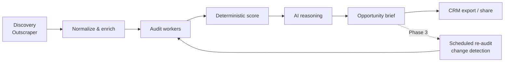

# Rove — Feature plan & DB design

Derived from the single source of truth: [`MVP.md`](./MVP.md). This document bridges the MVP narrative to the regenerated Prisma schema at [`../prisma/schema.prisma`](../prisma/schema.prisma).

## Product scope decision (locked)

Rove **researches** local-business prospects and turns evidence into sales-ready opportunity briefs, then **hands them off to a CRM** (export or integration). It is **not** an outbound engine.

**In scope:** lead discovery, modular evidence audits, Google Business Profile + reviews, competitor/market comparison, deterministic opportunity scoring, AI reasoning briefs, scheduled re-audits + change detection, CRM export/integration, brief sharing + view analytics, CSV export.

**Out of scope (not modeled, not built):** sending cold email, dialing call scripts, outbound sequences, follow-up automation, "campaign launch." The MVP's cold-email / call-script *text* is retained only as **research output** inside a brief (`Brief.coldEmailDraft`, `Brief.callScriptDraft`) that the agency exports — Rove never sends it.

> Note on "ignore phase 1 and 2": we are not limiting the build to the MVP's Phase-1 MVP cut. The schema below covers all phases now; features are implemented incrementally against this one schema.

## Auth & roles (built)

- **Email/password** signup + login via Better Auth (`/api/auth/*`). Session cookie, `req.auth` populated by `attachSession`.
- **Organization onboarding:** signup provisions one agency `Organization` + an `owner` `Membership` and sets the active org (`POST /api/workspaces`).
- **Org roles** (`MembershipRole`): `owner`, `admin`, `member` — scoped to one organization.
- **Platform super admin:** `User.isSuperAdmin` boolean (not an org role). Oversees all organizations via `/api/admin/*` behind `requireSuperAdmin()`. No self-signup — promote with `pnpm --filter @rove/api db:promote-admin -- <email>`.
- `/api/me` returns the user (incl. `isSuperAdmin`), active organization, and org role.

> Billing note: subscription / credit model is intentionally **not** modeled yet. It will likely add tables (plan, subscription, credit ledger) and columns on `Organization`/`UsageEvent` later. The monthly-ceiling columns already on `Organization` are the seam it will build on.

## The pipeline (MVP section 1)



## Feature families → data model

### 1. Discovery & enrichment
Pull prospects from Outscraper, normalize domains/names/phones, classify website type, dedupe, queue work.

| Model | Role |
| --- | --- |
| `Campaign` | A research run with structured location (`city`,`region`,`country`), niche, service type, filters, `maxLeads`, optional re-audit cadence. |
| `ExclusionDomain` | Domains to exclude (existing clients). |
| `Business` | Per-org business record; provider ids, NAP, rating/reviews, website URL, `normalizedDomain`, `websiteClass`, raw provider payload. |
| `CampaignLead` | Join of campaign↔business carrying `qualificationStatus`, `auditStatus`, `aiStatus`, `opportunityScore`. |

Identity: `Business @@unique([organizationId, provider, providerId])` — two agencies may discover the same place; each owns its own copy. `CampaignLead @@unique([campaignId, businessId])`.

### 2. Website evidence audits (MVP section 2.A–2.F)
Crawl owned sites (max pages, SSRF-guarded), run modular analyzers, emit normalized findings.

| Model | Role |
| --- | --- |
| `WebsiteSnapshot` | Reusable crawl per org, keyed by `contentHash`. Stores title, headings, tech stack, text size. |
| `SnapshotPage` | Each fetched page; role (home/services/contact/…), extracted CTAs/contact/forms, R2 screenshot ref. |
| `TechnicalAudit` | One `AuditModule` run against a snapshot for a lead; sub-score, `metrics` JSON, tool name/version, device profile, `observedAt`. |
| `AuditFinding` | Normalized record (MVP section 4): `code`, `kind` (finding/opportunity/hypothesis), `severity`, `source` (lab/field/profile/crawl/derived), `confidence`, `evidence` JSON. |

Audit modules (`AuditModule` enum): technical SEO, performance, security (TLS), accessibility, website experience/conversion, local SEO, reputation, content, technology, competitor.

Snapshot reuse is **per organization only** — no cross-tenant cache.

### 3. Local SEO: Google Business Profile + reviews (MVP 2.C, 2.D)

| Model | Role |
| --- | --- |
| `GbpProfile` | Per business: completeness score, categories, hours/photos/posts presence, owner responses, NAP consistency. |
| `Review` | Normalized review: rating, text, salted `authorHash` (no raw PII), sentiment, extracted themes, owner-responded. |

Healthcare guardrail (MVP): for healthcare niches, review text / patient stories are **not** sent to the model; findings stay technical.

### 4. Competitor & market intelligence (MVP 2.G)

| Model | Role |
| --- | --- |
| `CompetitorSet` | Comparison anchored on the subject lead; stores geography, category, `observedAt`, deterministic summary. |
| `Competitor` | Each comparator business: rating, review count, recent reviews, website/booking/contact signals. |

Store the comparator set + context + date; never claim a competitor "ranks higher in Google" from rating alone.

### 5. Deterministic opportunity engine (MVP section 4)
Normalize audit results, compute module sub-scores (`TechnicalAudit.score`) and a lead score (`CampaignLead.opportunityScore`, 0–100). Keep **finding / opportunity / hypothesis** separate (`FindingKind`).

### 6. AI reasoning → opportunity brief (MVP sections 4, 5)

| Model | Role |
| --- | --- |
| `Brief` | Per-lead reasoning output. `content` JSON (Zod-validated), `headlineOpportunity`, `suggestedService`, `confidence`, research text (`valueProposition`, `outreachAngle`, `coldEmailDraft`, `callScriptDraft`), `status` (draft→approved→published→archived), unguessable `publicToken`, optional R2 `pdfFile`. |
| `BriefEvent` | Share analytics: `VIEW` / `UNIQUE_VIEW` / `CTA_CLICK`, salted `visitorHash`, `suspectedBot`. No raw IP, no `viewCount` integer. |

Reasoning gate (MVP): only the top-K scored leads above a threshold go to the model; the rest get `aiStatus = SKIPPED_GATE` or a deterministic draft. Model failure → `aiStatus = UNAVAILABLE` with a deterministic draft. Untrusted page text is passed as data, never concatenated into the system prompt.

### 7. Re-audit & change detection (Phase 3)

| Model | Role |
| --- | --- |
| `Campaign.reauditCadence` / `lastReauditAt` | Schedule periodic re-audits (`OFF`/`WEEKLY`/`MONTHLY`/`QUARTERLY`). |
| `AuditChange` | Detected deltas: score up/down, finding resolved/new, content changed, went offline/online. |

### 8. CRM export / integration (the "execution" endpoint)

| Model | Role |
| --- | --- |
| `CrmConnection` | Per-org CRM connection; provider, encrypted credentials or webhook URL. |
| `CrmExport` | A push of a lead/brief to a CRM (or CSV/webhook); status, external id, payload for traceability. |

### 9. Files (Cloudflare R2)

| Model | Role |
| --- | --- |
| `StoredFile` | Object metadata only (bucket, key, type, size, checksum) for screenshots, PDFs, CSV exports, logos. |

### 10. Jobs & usage metering (guardrails)

| Model | Role |
| --- | --- |
| `Job` | Domain-visible job row (`DISCOVER`/`CRAWL`/`AUDIT`/`INTERPRET`/`COMPETITOR`/`REAUDIT`/`EXPORT`), decoupled from pg-boss retries. |
| `UsageEvent` | Metered units: Maps records, pages fetched, Lighthouse runs, LLM in/out tokens, files stored; optional provider cost. |
| `Organization.{mapsRecordLimit,pageFetchLimit,llmTokenLimit}` | Monthly ceilings, refused before the next unit of work. |

## Status fields (kept separate — one enum can't mean everything)

| Field | Lives on | Meaning |
| --- | --- | --- |
| `qualificationStatus` | `CampaignLead` | Lead qualification (new/qualified/excluded/…). |
| `auditStatus` | `CampaignLead` / `TechnicalAudit` | Crawl/audit lifecycle. |
| `aiStatus` | `CampaignLead` / `Brief` | Reasoning pass state. |
| `websiteClass` | `Business` | How the Maps URL is classified; only `OWNED_SITE` is crawled. |
| `status` (`CampaignStatus`) | `Campaign` | Run state machine (draft→…→completed/partial/failed/cancelled). |
| `status` (`BriefStatus`) | `Brief` | draft→approved→published→archived. |

## Campaign state machine

```
DRAFT → QUEUED → DISCOVERING → PROCESSING → COMPLETED
                                          ↘ PARTIALLY_COMPLETED (some leads failed)
                                          ↘ PAUSED  (provider quota / 429, work saved)
                                          ↘ FAILED  (discovery produced nothing)
                                          ↘ CANCELLED (operator cancel; finished leads stay)
```
A single dead website or one model failure never fails the campaign.

## Guardrails baked into the model (MVP section 7)

- **SSRF:** crawl workers block private/loopback/link-local/metadata targets, re-check after DNS + redirects. (Enforced in the fetch/browser plugin, not the DB.)
- **Per-tenant isolation:** snapshots, reviews, briefs, and AI output never shared across organizations.
- **PII:** reviews/analytics store salted hashes, not raw author identity or IP.
- **Untrusted input:** scraped HTML/review text is data; it can never override model instructions.
- **Budgets:** monthly ceilings per org refuse work before spend.

## Suggested build order (one Prisma migration per step)

1. Auth + Organization/Membership (foundation). *(present)*
2. Discovery: Campaign, ExclusionDomain, Business, CampaignLead. *(present)*
3. Evidence: WebsiteSnapshot, SnapshotPage, TechnicalAudit, AuditFinding + fetch plugin.
4. Local SEO: GbpProfile, Review.
5. Scoring + AI: opportunityScore, Brief, BriefEvent + LLM plugin.
6. Competitor: CompetitorSet, Competitor.
7. Files: StoredFile + R2 plugin (screenshots, PDFs).
8. CRM: CrmConnection, CrmExport + CSV export.
9. Phase 3: reauditCadence, AuditChange + scheduler.

The schema already defines all of the above so relations are stable; migrations can still land feature-by-feature.
