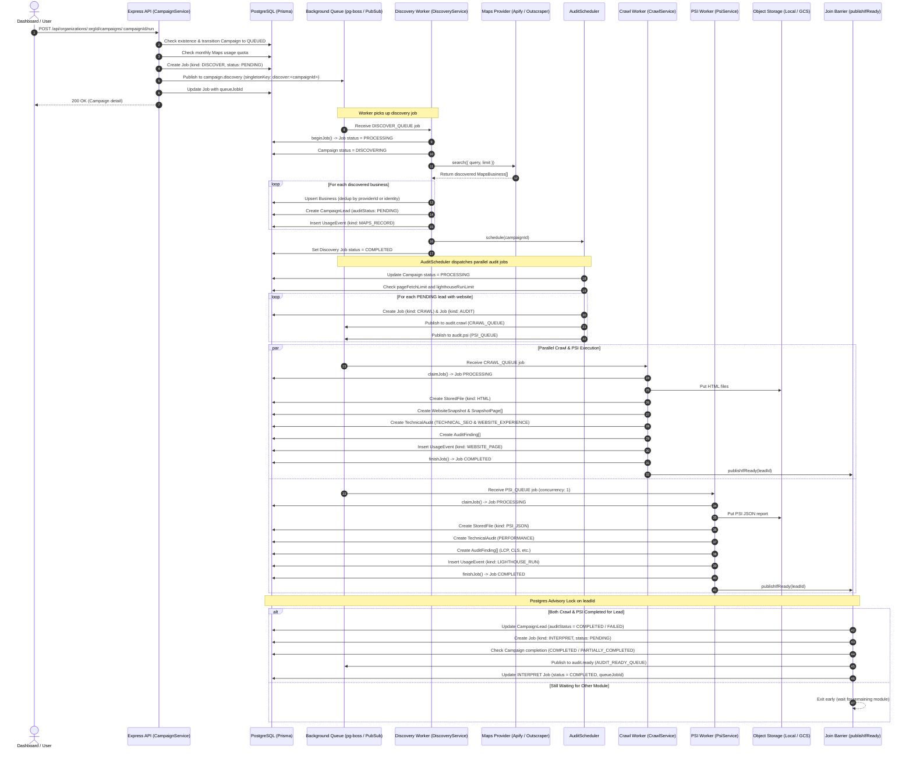

# Campaign Run: Complete End-to-End Execution Flow

This document details the complete technical flow of running a campaign in Rove: from the moment the user triggers the run via the API, through background discovery, parallel crawling and PageSpeed auditing, database record transitions, and the final join barrier that enqueues AI brief interpretation.

---

## 1. High-Level Architecture & Lifecycle Diagram



---

## 2. Phase-by-Phase Execution Details

### Phase 1: Campaign Run Trigger (Synchronous HTTP Layer)

1. **Client Request**:
   - The user clicks **Run Campaign** in the frontend dashboard.
   - Endpoint: `POST /api/organizations/:orgId/campaigns/:campaignId/run`
   - Authenticated via session cookie through Better Auth.
2. **Routing & Controller**:
   - Handled by `campaignRoutes` ([campaign.routes.ts](file:///Users/apple/Documents/roveAi/apps/api/src/features/campaigns/campaign.routes.ts#L19)).
   - Invokes `CampaignController.run` ([campaign.controller.ts](file:///Users/apple/Documents/roveAi/apps/api/src/features/campaigns/campaign.controller.ts#L38-L45)).
3. **Service Logic (`CampaignService.run`)**:
   - Validates organization tenancy and campaign existence via `repository.getDetail()`.
   - **Atomic Claim**: Calls `repository.claimRun(orgId, campaignId)`.
     - Validates that `Campaign.status` is NOT already in `['QUEUED', 'DISCOVERING', 'PROCESSING']`.
     - Atomically updates `Campaign.status = 'QUEUED'`.
   - **Quota Check**:
     - Calculates current usage from `usage_event` where `kind = 'MAPS_RECORD'` in the current UTC month.
     - Compares `(used + maxLeads)` against `organization.mapsRecordLimit`.
     - If exceeded, rolls campaign status back to its previous state and throws `BadRequestError`.
   - **Job Creation & Queue Dispatch**:
     - Inserts a new row in the `job` table with `kind: 'DISCOVER'`, `status: 'PENDING'`.
     - Publishes payload `{ campaignId, jobId: job.id }` to `DISCOVER_QUEUE` (`"campaign.discovery"`) using a singleton key `discover:<campaignId>`.
     - Saves the returned message ID to `job.queueJobId`.
4. **HTTP Response**:
   - Immediately returns HTTP `200 OK` with the updated campaign details and status `"QUEUED"`.

**Database Tables Touched in Phase 1:**
- `campaign` (read status, update `status = 'QUEUED'`)
- `organization` (read `mapsRecordLimit`)
- `usage_event` (aggregate monthly `MAPS_RECORD` sum)
- `job` (insert row with `kind: 'DISCOVER'`, update `queueJobId`)

---

### Phase 2: Discovery Worker (`campaign.discovery`)

1. **Worker Process & Subscription**:
   - Started via `worker.ts` -> `runRole("discover")` ([run-role.ts](file:///Users/apple/Documents/roveAi/apps/api/src/entries/run-role.ts#L9-L31)).
   - Subscribes via `subscribeAuditRole` ([audit.workers.ts](file:///Users/apple/Documents/roveAi/apps/api/src/features/audits/audit.workers.ts#L52-L56)) to `DISCOVER_QUEUE` (`"campaign.discovery"`).
2. **Handler Execution (`DiscoveryService.run`)**:
   - File: [discovery.service.ts](file:///Users/apple/Documents/roveAi/apps/api/src/features/campaigns/discovery.service.ts#L15-L35).
   - Calls `repository.beginJob(jobId)`: claims the job lock, updates `job.status = 'PROCESSING'`, and increments `attemptCount`.
   - Calls `repository.markDiscovering(campaignId)`: updates `Campaign.status = 'DISCOVERING'`.
3. **Search & Lead Scraping**:
   - Generates search query variations with `expandQueries(campaign)` (e.g. niche + city combinations).
   - Calls the active Maps provider via `maps.search({ query, limit })` (e.g., Apify, Outscraper, SerpApi, Google Places).
4. **Lead Ingestion & Deduplication (`DiscoveryService.ingest`)**:
   - Iterates over each raw business found:
     - **Website Classification**: `classifyWebsite(websiteUrl)` categorizes into `OWNED_SITE`, `SOCIAL_OR_DIRECTORY`, or `MISSING`.
     - **Filter Checks**: Checks `minRating`, `minReviewCount`, and `websiteFilter`.
     - **Exclusions**: Evaluates `exclusionMatches` against campaign exclusion domains (`qualificationStatus: "EXCLUDED_EXISTING_CLIENT" | "NEW"`).
     - **Audit Status Determination**:
       - `OWNED_SITE` -> `auditStatus = "PENDING"`
       - `MISSING` -> `auditStatus = "SKIPPED_NO_WEBSITE"`
       - `SOCIAL_OR_DIRECTORY` -> `auditStatus = "SKIPPED_NOT_OWNED_SITE"`
   - Calls `repository.saveLead(...)` ([campaign.repository.ts](file:///Users/apple/Documents/roveAi/apps/api/src/features/campaigns/campaign.repository.ts#L303-L409)):
     - **Business Deduplication**: Checks for existing `business` by `[organizationId, provider, providerId]`. If absent, checks normalized identity `[organizationId, normalizedName, normalizedPhone, city]`.
     - **Inserts/Reuses `Business`**: Creates row if new.
     - **Creates `CampaignLead`**: Links `campaignId` to `businessId`.
     - **Records Metering**: Inserts row into `usage_event` (`kind: "MAPS_RECORD"`, `quantity: 1`).
5. **Handoff to Audit Scheduler**:
   - If the campaign is still in `DISCOVERING` status, calls:
     ```typescript
     await this.audits.schedule(campaignId);
     ```
   - Marks discovery job complete: `repository.setJobStatus(jobId, "COMPLETED")`.

**Database Tables Touched in Phase 2:**
- `job` (`status: PROCESSING -> COMPLETED`)
- `campaign` (`status: QUEUED -> DISCOVERING`)
- `business` (read/insert deduplicated business profile)
- `campaign_lead` (insert lead records linking business to campaign)
- `usage_event` (insert `MAPS_RECORD` events for quota tracking)

---

### Phase 3: Audit Scheduling & Queue Dispatch (`AuditScheduler`)

1. **Targeting Qualified Leads**:
   - File: [audit-scheduler.ts](file:///Users/apple/Documents/roveAi/apps/api/src/features/audits/audit-scheduler.ts#L15-L79).
   - Queries `campaign_lead` where `campaignId = campaignId`, `auditStatus = 'PENDING'`, and `business.websiteClass = 'OWNED_SITE'`.
   - If no leads need technical auditing, calls `completeIfIdle(campaignId)` and exits.
2. **State Transition**:
   - Updates `Campaign.status` from `'DISCOVERING'` to `'PROCESSING'`.
3. **Budget Validation**:
   - Reads `organization.pageFetchLimit` and `organization.lighthouseRunLimit`.
   - Queries current monthly totals from `usage_event` for `WEBSITE_PAGE` and `LIGHTHOUSE_RUN`.
4. **Dispatching Parallel Jobs**:
   - For each lead:
     - If monthly ceilings are exceeded, updates `CampaignLead.auditStatus = 'SKIPPED_BUDGET'`.
     - Otherwise, prepares the canonical website URL and creates two independent jobs:
       1. **Crawl Job**: Creates `job` record (`kind: 'CRAWL'`, `status: 'PENDING'`) and publishes to `CRAWL_QUEUE` (`"audit.crawl"`).
       2. **PSI Job**: Creates `job` record (`kind: 'AUDIT'`, `status: 'PENDING'`) and publishes to `PSI_QUEUE` (`"audit.psi"`).
     - Payload for both:
       ```json
       {
         "organizationId": "...",
         "campaignId": "...",
         "leadId": "...",
         "businessId": "...",
         "jobId": "...",
         "url": "https://example.com"
       }
       ```
     - Saves the queue message ID to `job.queueJobId`.

**Database Tables Touched in Phase 3:**
- `campaign` (`status: DISCOVERING -> PROCESSING`)
- `campaign_lead` (read pending leads, update skipped budget if over limit)
- `organization` (read fetch & lighthouse limits)
- `usage_event` (aggregate monthly usage)
- `job` (insert rows with `kind: 'CRAWL'` and `kind: 'AUDIT'`)

---

### Phase 4A: Parallel Worker 1 — Crawl Service (`audit.crawl`)

1. **Worker Process & Subscription**:
   - Subscribed via `subscribeAuditRole(registry, "crawl")`.
   - Concurrency: `WORKER_CONCURRENCY` (default: 4).
2. **Job Claim**:
   - `claimJob(prisma, jobId)`: Sets `job.status = 'PROCESSING'` under timeout lock.
3. **Execution (`CrawlService.run`)**:
   - File: [crawl.service.ts](file:///Users/apple/Documents/roveAi/apps/api/src/features/audits/crawl.service.ts#L28-L50).
   - **Cache Check (`reuseRecent`)**: Checks if a `website_snapshot` exists for `businessId` within the last 24 hours. If found, reuses cached pages without re-fetching.
   - **SSRF & Security Validation**: Validates URL format with `parseHttpUrl`.
   - **Robots.txt & Sitemap Inspection**:
     - Fetches `/robots.txt` and checks if homepage is allowed (`robotsAllows`).
     - Fetches `/sitemap.xml` and discovers up to `CRAWL_MAX_PAGES` target URLs (`selectCrawlUrls`).
   - **Page Fetching**:
     - Fetches each page HTML via Cheerio / PageFetcher.
     - Inspects structural HTML tags: `<title>`, `<h1>`, `<h2>`, images missing alt text, phone numbers (`tel:`), emails (`mailto:`), contact forms, and visible text size.
   - **Storage & Snapshots**:
     - Calculates `contentHash` of the combined page content.
     - Saves each page HTML to Object Storage (`.data/objects` or GCS bucket) at:
       `org/<orgId>/snapshots/<snapshotId>/<hash>.html`
     - Inserts a `stored_file` row for each page (`kind: "HTML"`).
     - Inserts/reuses `website_snapshot` record with structural metadata.
     - Inserts `snapshot_page` records linking each page to its `stored_file.id`.
   - **Technical SEO & Experience Analyzers**:
     - Analyzes collected pages and computes deterministic scores (0–100).
     - Calls `replaceAudit` to create/update 2 records in `technical_audit`:
       1. `module: "TECHNICAL_SEO"`
       2. `module: "WEBSITE_EXPERIENCE"`
     - Inserts normalized `audit_finding` rows (e.g. `MISSING_TITLE`, `NO_H1`, `MISSING_ALT`, `NO_PHONE_OR_EMAIL`).
   - **Usage Metering**:
     - Inserts `usage_event` with `kind: "WEBSITE_PAGE"`, `quantity = number of pages fetched`.
4. **Completion & Join Trigger**:
   - Calls `finishJob(prisma, jobId, "COMPLETED")` -> updates `job.status = 'COMPLETED'`.
   - Calls `publishIfReady(prisma, queue, payload)`.

**Database & Storage Touched in Phase 4A:**
- Object Storage / Local Disk (`.data/objects/org/.../snapshots/...`)
- `stored_file` (insert rows with `kind: 'HTML'`)
- `website_snapshot` (insert snapshot metadata)
- `snapshot_page` (insert page extractions & link to `stored_file`)
- `technical_audit` (insert/update `TECHNICAL_SEO` and `WEBSITE_EXPERIENCE` rows)
- `audit_finding` (insert normalized finding rows)
- `usage_event` (insert `WEBSITE_PAGE` row)
- `job` (`status: PROCESSING -> COMPLETED`)

---

### Phase 4B: Parallel Worker 2 — PSI Service (`audit.psi`)

1. **Worker Process & Subscription**:
   - Subscribed via `subscribeAuditRole(registry, "psi")`.
   - Concurrency: `1` (ensures serialized PageSpeed requests to avoid Google API rate limits).
2. **Job Claim**:
   - `claimJob(prisma, jobId)`: Sets `job.status = 'PROCESSING'`.
3. **Execution (`PsiService.run`)**:
   - File: [psi.service.ts](file:///Users/apple/Documents/roveAi/apps/api/src/features/audits/psi.service.ts#L21-L51).
   - **Cache Check (`reuseToday`)**: Reuses today's audit if already executed.
   - **Google Lighthouse Run**:
     - Executes mobile PageSpeed Insights audit via `pagespeed.runMobile(url)`.
     - Extracts Core Web Vitals: LCP (Largest Contentful Paint), CLS (Cumulative Layout Shift), FCP, TBT, Speed Index, and performance score.
   - **Storage & Files**:
     - Saves raw Lighthouse JSON to Object Storage at:
       `org/<orgId>/pagespeed/<jobId>.json`
     - Inserts a `stored_file` row (`kind: "PSI_JSON"`).
   - **Technical Performance Audit**:
     - Calls `replaceAudit` to create/update 1 record in `technical_audit`:
       - `module: "PERFORMANCE"`
       - `score`: Mobile performance score (0–100)
       - `metrics`: `{ lcp_ms, cls, fcp_ms, tbt_ms, rawObjectKey }`
     - Inserts normalized `audit_finding` rows (e.g. `SLOW_LCP`, `HIGH_CLS`).
   - **Usage Metering**:
     - Inserts `usage_event` with `kind: "LIGHTHOUSE_RUN"`, `quantity = 1`.
4. **Completion & Join Trigger**:
   - Calls `finishJob(prisma, jobId, "COMPLETED")` -> updates `job.status = 'COMPLETED'`.
   - Calls `publishIfReady(prisma, queue, payload)`.

**Database & Storage Touched in Phase 4B:**
- Object Storage / Local Disk (`.data/objects/org/.../pagespeed/...`)
- `stored_file` (insert row with `kind: 'PSI_JSON'`)
- `technical_audit` (insert/update `PERFORMANCE` row)
- `audit_finding` (insert performance finding rows)
- `usage_event` (insert `LIGHTHOUSE_RUN` row)
- `job` (`status: PROCESSING -> COMPLETED`)

---

### Phase 5: Join Barrier & State Synchronization (`publishIfReady`)

Both Crawl and PSI call `publishIfReady` upon completion or terminal failure. The function coordinates parallel completion without race conditions:

1. **Advisory Transaction Lock**:
   - File: [audit-join.ts](file:///Users/apple/Documents/roveAi/apps/api/src/features/audits/audit-join.ts#L6-L68).
   - Executes `SELECT pg_advisory_xact_lock(hashtextextended(leadId, 0))`.
   - Ensures only one worker at a time checks and updates a given lead.
2. **Evaluates Lead Module Readiness (`leadAuditStatus`)**:
   - Queries `technical_audit` for the 3 required modules:
     - `TECHNICAL_SEO`
     - `WEBSITE_EXPERIENCE`
     - `PERFORMANCE`
   - If any required module is still missing or non-terminal (`PENDING`), it exits cleanly and waits for the sibling worker to finish.
3. **Lead & Campaign Advancement**:
   - When all 3 modules reach a terminal state:
     - Updates `CampaignLead.auditStatus` from `'PENDING'` to `'COMPLETED'` (or `'BLOCKED'`, `'UNREACHABLE'`, `'FAILED'`, `'SKIPPED_BY_ROBOTS'`).
     - Evaluates all leads across the campaign via `campaignOutcome(statuses)`:
       - If zero leads remain in `PENDING`, updates `Campaign.status` from `'PROCESSING'` to `'COMPLETED'` (or `'PARTIALLY_COMPLETED'` if hard errors occurred).
4. **Downstream Handoff (`INTERPRET` Queue)**:
   - Creates or finds a `job` row with `kind: 'INTERPRET'`, `status: 'PENDING'`.
   - Publishes payload `{ ...payload, jobId: interpretJobId }` to `AUDIT_READY_QUEUE` (`"audit.ready"`).
   - Updates `job.queueJobId = messageId` and `job.status = 'COMPLETED'` (marking dispatch complete).

**Database Tables Touched in Phase 5:**
- `technical_audit` (query latest status per module)
- `campaign_lead` (`auditStatus: PENDING -> COMPLETED / FAILED`)
- `campaign` (`status: PROCESSING -> COMPLETED / PARTIALLY_COMPLETED`)
- `job` (create row with `kind: 'INTERPRET'`, update `queueJobId`)

---

### Phase 6: Downstream Pipeline (What Happens Next)

Once the job is published to `audit.ready` (`AUDIT_READY_QUEUE`), the downstream system performs the following stages:

1. **Deterministic Opportunity Scoring & Service Matching**:
   - Reads `audit_finding` records and maps them to agency service offers (e.g. Local SEO, Core Web Vitals Optimization, Web Redesign).
   - Writes computed scores to `lead_score`, `lead_opportunity`, and `lead_match`.
2. **AI Reasoning Worker (LLM Brief Generation)**:
   - Reads the lead’s business details, snapshot headings, and audit findings.
   - Produces a structured, sales-ready [`Brief`](file:///Users/apple/Documents/roveAi/apps/api/prisma/schema.prisma#L1055-L1091) record:
     - `headlineOpportunity` (the key hook for sales reps)
     - `suggestedService`
     - `valueProposition` & `outreachAngle`
     - `coldEmailDraft` & `callScriptDraft`
     - `publicToken` (unguessable token for public link sharing)
3. **PDF Report Generation**:
   - Generates a branded audit PDF summarizing the score and findings.
   - Saves the PDF to Object Storage and links its ID to `Brief.pdfFileId`.
4. **CRM Export & Sharing**:
   - The agency exports the lead and brief to external CRMs (HubSpot, Salesforce, Pipedrive, CSV) or shares the public link.

---

## 3. Master Summary Table of Database Tables Involved

| Database Table | Read / Write | In Which Phase? | Purpose / Contents |
| :--- | :--- | :--- | :--- |
| **`campaign`** | Read & Write | Phase 1, 2, 3, 5 | Tracks overall campaign lifecycle: `DRAFT` → `QUEUED` → `DISCOVERING` → `PROCESSING` → `COMPLETED` / `PARTIALLY_COMPLETED`. |
| **`organization`** | Read | Phase 1, 3 | Enforces multi-tenant isolation and defines usage ceilings (`mapsRecordLimit`, `pageFetchLimit`, `lighthouseRunLimit`). |
| **`usage_event`** | Read & Write | Phase 1, 2, 3, 4A, 4B | Tracks resource consumption per organization/campaign (`MAPS_RECORD`, `WEBSITE_PAGE`, `LIGHTHOUSE_RUN`). |
| **`job`** | Read & Write | Phase 1, 2, 3, 4A, 4B, 5 | Domain-visible job ledger tracking job progress (`DISCOVER`, `CRAWL`, `AUDIT`, `INTERPRET`). |
| **`business`** | Read & Write | Phase 2 | Stores normalized company profiles (name, address, phone, Google rating, website, classified website type). |
| **`campaign_lead`** | Read & Write | Phase 2, 3, 5 | Join entity linking `Business` to `Campaign`. Tracks `qualificationStatus` and `auditStatus`. |
| **`website_snapshot`** | Read & Write | Phase 4A | Deduplicated snapshot of a business website identified by `contentHash`. Stores titles, headings, and tech stack. |
| **`snapshot_page`** | Write | Phase 4A | Represents individual crawled pages of a snapshot with extracted structural signals (CTAs, phone count, forms, missing alt tags). |
| **`stored_file`** | Write | Phase 4A, 4B | Catalog of raw assets stored in Object Storage (`HTML` crawl files and `PSI_JSON` reports). |
| **`technical_audit`** | Read & Write | Phase 4A, 4B, 5 | Stores normalized audit module outcomes and scores (`TECHNICAL_SEO`, `WEBSITE_EXPERIENCE`, `PERFORMANCE`). |
| **`audit_finding`** | Write | Phase 4A, 4B | Normalized evidence rows with stable codes (e.g. `SLOW_LCP`, `MISSING_TITLE`, `MISSING_ALT`, `HIGH_CLS`). |
| **`lead_score` / `brief`** | Write | Phase 6 (Downstream) | Downstream AI and scoring output generated from the audit findings and snapshot data. |
