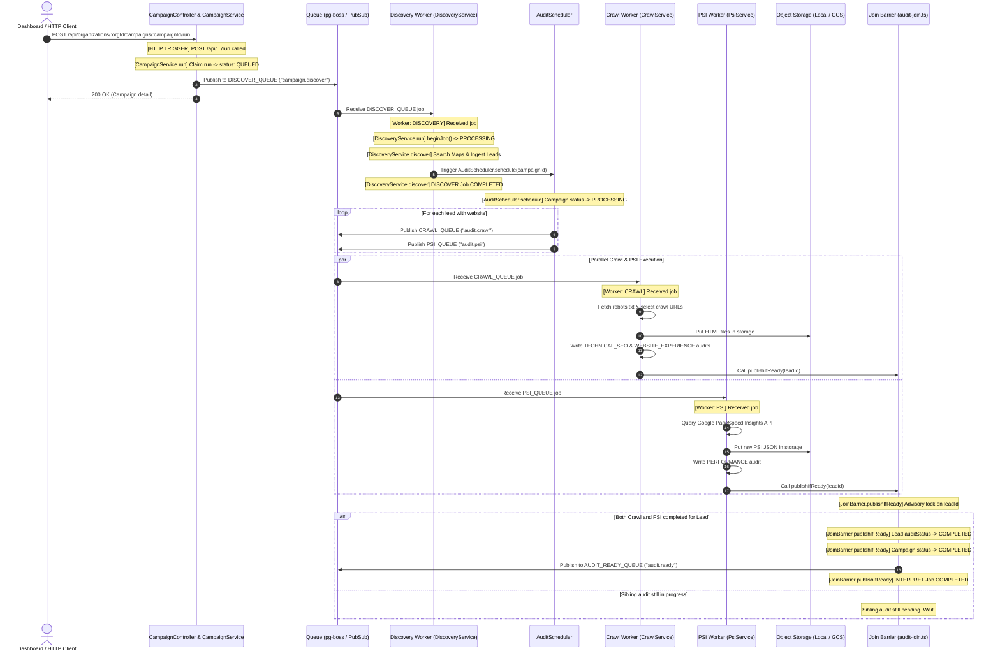

# Rove Campaign Execution Flow & Console Log Trace

This document maps out the complete execution sequence and corresponding console logs emitted across the workflow when a campaign is run, from the HTTP trigger to the downstream hand-off.

---

## High-Level Sequence of Triggers & Workers



---

## Detailed Step-by-Step Console Log Trace

### Step 1: Campaign Run HTTP Trigger
* **Triggered by:** `POST /api/organizations/:orgId/campaigns/:campaignId/run`
* **File:** `apps/api/src/features/campaigns/campaign.controller.ts` & `campaign.service.ts`

```text
======================================================
[HTTP TRIGGER] 🚀 POST /api/organizations/<orgId>/campaigns/<campaignId>/run
======================================================
[CampaignService.run] 🎯 Initiating run for campaignId: <campaignId>
[CampaignService.run] ✅ Claimed campaign run. Campaign status -> QUEUED
[CampaignService.run] 📊 Maps quota check: 0 used + 10 requested <= 500 limit
[CampaignService.run] 📋 Created Job row (id: <jobId>, kind: DISCOVER, status: PENDING)
[CampaignService.run] 📤 Publishing to DISCOVER_QUEUE ("campaign.discover") with singletonKey discover:<campaignId>
[CampaignService.run] 💾 Linked queue message ID (<messageId>) to Job (<jobId>)
```

---

### Step 2: Discovery Worker (`campaign.discover`)
* **Triggered by:** `subscribeAuditRole` in `audit.workers.ts` picking up the discovery message
* **File:** `apps/api/src/features/campaigns/discovery.service.ts`

```text
------------------------------------------------------
[Worker: DISCOVERY] 📥 Received DISCOVER_QUEUE job: campaignId=<campaignId>, jobId=<jobId> (attempt 1/3)
------------------------------------------------------
[DiscoveryService.run] 🚀 Discovery started for campaign <campaignId>, jobId: <jobId>
[DiscoveryService.run] 🔒 beginJob status: "ready" for jobId: <jobId>
[DiscoveryService.discover] 📦 Loaded campaign "plumber" in "Austin" (maxLeads: 10)
[DiscoveryService.discover] 🔄 Campaign status -> DISCOVERING
[DiscoveryService.discover] 🔎 Generated 2 query variations: ["plumber Austin", "plumbing contractor Austin"]
[DiscoveryService.discover] 🌐 Searching Maps provider for: "plumber Austin" (need 10 more)
[DiscoveryService.discover] 📍 Maps provider returned 10 results
[DiscoveryService.ingest] ✅ Saved lead #1: "Acme Plumbing Austin" (https://acmeplumbing.com)
[DiscoveryService.ingest] ✅ Saved lead #2: "Capitol City Plumbers" (https://capitolcityplumbing.com)
...
[DiscoveryService.discover] 🏁 Discovery finished with 10/10 leads saved.
[DiscoveryService.discover] ⏩ Handoff: Triggering AuditScheduler.schedule(<campaignId>)
```

---

### Step 3: Audit Scheduler (`AuditScheduler`)
* **Triggered by:** `DiscoveryService.discover` calling `this.audits.schedule(campaignId)`
* **File:** `apps/api/src/features/audits/audit-scheduler.ts`

```text
======================================================
[AuditScheduler.schedule] 🗓️ Starting audit scheduler for campaign: <campaignId>
======================================================
[AuditScheduler.schedule] 🎯 Found 10 qualified leads with OWNED_SITE in PENDING status
[AuditScheduler.schedule] 🔄 Campaign <campaignId> status -> PROCESSING
[AuditScheduler.schedule] 📊 Monthly budget usage: pages=0/1000, psi=0/200
[AuditScheduler.schedule] 🚀 Dispatching parallel CRAWL and PSI jobs for: "Acme Plumbing Austin" (https://acmeplumbing.com)
[AuditScheduler.ensureJob] 📋 Created CRAWL Job row: <crawlJobId> for lead: <leadId>
[AuditScheduler.ensureJob] 📤 Publishing to queue "audit.crawl" for lead <leadId> (kind: CRAWL)
[AuditScheduler.ensureJob] 💾 Linked messageId <msgId1> to CRAWL Job <crawlJobId>
[AuditScheduler.ensureJob] 📋 Created AUDIT Job row: <psiJobId> for lead: <leadId>
[AuditScheduler.ensureJob] 📤 Publishing to queue "audit.psi" for lead <leadId> (kind: AUDIT)
[AuditScheduler.ensureJob] 💾 Linked messageId <msgId2> to AUDIT Job <psiJobId>
...
[DiscoveryService.discover] ✨ DISCOVER Job <jobId> status -> COMPLETED
```

---

### Step 4A: Crawl Worker (`audit.crawl`)
* **Triggered by:** Worker subscribed to `audit.crawl`
* **File:** `apps/api/src/features/audits/crawl.service.ts`

```text
------------------------------------------------------
[Worker: CRAWL] 📥 Received CRAWL_QUEUE job: leadId=<leadId>, url=https://acmeplumbing.com (attempt 1/3)
------------------------------------------------------
[CrawlService.run] 🕷️ Crawl job started for lead: <leadId> (https://acmeplumbing.com)
[CrawlService.run] 🔒 Job claim result: "ready" for jobId: <crawlJobId>
[CrawlService.execute] 🌐 Fetching homepage: https://acmeplumbing.com
[CrawlService.execute] 📥 Fetched homepage: status=200, finalUrl=https://acmeplumbing.com/
[CrawlService.execute] 🎯 Discovered 4 pages from sitemap/links to crawl
[CrawlService.execute] 📄 Crawled sub-page: https://acmeplumbing.com/about (status: 200)
[CrawlService.execute] 📄 Crawled sub-page: https://acmeplumbing.com/services (status: 200)
[CrawlService.execute] 📄 Crawled sub-page: https://acmeplumbing.com/contact (status: 200)
[CrawlService.execute] 🔍 Analyzing 4 pages and computing content hash...
[CrawlService.execute] 💾 Stored WebsiteSnapshot ID: <snapshotId>
[CrawlService.writeCompleted] ✍️ Writing audits -> TECHNICAL_SEO score: 85 (2 findings), WEBSITE_EXPERIENCE score: 90 (1 findings)
[CrawlService.execute] 📊 Recorded WEBSITE_PAGE usage (+4)
[CrawlService.run] ✅ Crawl completed for lead: <leadId>. Triggering publishIfReady()
```

---

### Step 4B: PSI Worker (`audit.psi`)
* **Triggered by:** Worker subscribed to `audit.psi`
* **File:** `apps/api/src/features/audits/psi.service.ts`

```text
------------------------------------------------------
[Worker: PSI] 📥 Received PSI_QUEUE job: leadId=<leadId>, url=https://acmeplumbing.com (attempt 1/3)
------------------------------------------------------
[PsiService.run] ⚡ PSI job started for lead: <leadId> (https://acmeplumbing.com)
[PsiService.run] 🔒 Job claim result: "ready" for jobId: <psiJobId>
[PsiService.execute] 🌐 Calling Google PageSpeed Insights API (mobile) for: https://acmeplumbing.com
[PsiService.execute] 💾 Saving raw PSI JSON to Object Storage (key: org/<orgId>/pagespeed/<jobId>.json)
[PsiService.execute] ✍️ Writing PERFORMANCE audit -> score: 72/100, LCP: 3100ms, CLS: 0.08 (1 findings)
[PsiService.execute] 📊 Recorded LIGHTHOUSE_RUN usage (+1)
[PsiService.run] ✅ PSI completed for lead: <leadId>. Triggering publishIfReady()
```

---

### Step 5: Join Barrier & Downstream Handoff (`publishIfReady`)
* **Triggered by:** Both Crawl and PSI workers when finishing a lead
* **File:** `apps/api/src/features/audits/audit-join.ts`

#### When 1st Worker Finishes (e.g., Crawl finishes, PSI still running):
```text
[JoinBarrier.publishIfReady] 🔀 Evaluating lead completion for lead: <leadId> (jobId: <crawlJobId>)
[JoinBarrier.publishIfReady] 📋 Module states for lead <leadId> -> [TECHNICAL_SEO: COMPLETED, WEBSITE_EXPERIENCE: COMPLETED]
[JoinBarrier.publishIfReady] ⏳ Sibling audit module still running for lead <leadId>. Exiting lock.
```

#### When 2nd Worker Finishes (PSI finishes):
```text
[JoinBarrier.publishIfReady] 🔀 Evaluating lead completion for lead: <leadId> (jobId: <psiJobId>)
[JoinBarrier.publishIfReady] 📋 Module states for lead <leadId> -> [TECHNICAL_SEO: COMPLETED, WEBSITE_EXPERIENCE: COMPLETED, PERFORMANCE: COMPLETED]
[JoinBarrier.publishIfReady] 🎉 All modules reached terminal state! Updating lead <leadId> auditStatus -> "COMPLETED"
[JoinBarrier.publishIfReady] 📋 Created INTERPRET Job row: <interpretJobId>
[JoinBarrier.publishIfReady] 🏆 All campaign leads evaluated! Campaign status -> "COMPLETED"
[JoinBarrier.publishIfReady] 📤 Publishing to AUDIT_READY_QUEUE ("audit.ready") with interpretJobId: <interpretJobId>
[JoinBarrier.publishIfReady] ✨ Dispatched downstream interpret job <interpretJobId> (queueJobId: <messageId>)
```
