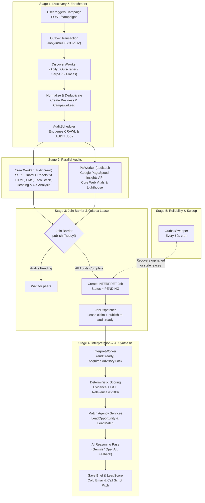

# Rove — Architecture & Worker Pipeline

> **Source of Truth**: [`apps/api/doc/MVP.md`](../apps/api/doc/MVP.md)  
> **Status**: Production Implementation (Multi-Tenant, Dual-Plane RBAC, Dual-Driver Queue, Parallel Auditing, Interpret AI Engine)

---

## 1. System Overview & Monorepo Topology

Rove is an automated research and opportunity engine for digital marketing agencies. It identifies high-value local business prospects, conducts deep multi-module audits (Technical SEO, UX, Core Web Vitals / Performance, Security), scores opportunities deterministically, reasons over the evidence using LLMs (Gemini / OpenAI), and compiles sales-ready opportunity briefs.

The repository is structured as a **pnpm workspace monorepo orchestrated with Turborepo**:

```
rove/
├── apps/
│   ├── api/          # Express 5 + Prisma 7 + Worker Pipeline (:3000)
│   ├── web/          # Next.js 15 SaaS Marketing Website (:3001)
│   ├── agency-web/   # Next.js 15 Agency Marketing Portal (:3002)
│   ├── dashboard/    # Vite 6 + React 19 Agency Dashboard SPA (:5173)
│   └── studio/       # Sanity Studio v3 Content Management (:3333)
├── packages/
│   ├── ui/           # Shared Shadcn UI / Radix / Tailwind component library
│   ├── cms/          # Shared Sanity schemas, queries, and client bindings
│   └── config-ts/    # Shared TypeScript configurations
└── docs/             # Platform architectural & operational documentation
```

---

## 2. Dual-Plane RBAC Architecture

Rove enforces strict multi-tenancy and administrative oversight through two decoupled authorization planes:

```
┌────────────────────────────────────────────────────────────────────────┐
│ Platform Plane (Global Oversight)                                      │
│ - User.platformRole: SUPER_ADMIN | SUPPORT | MEMBER                    │
│ - User.isSuperAdmin: boolean                                           │
│ - PlatformSetting: global defaults (e.g., active DiscoveryProvider)   │
│ - Endpoints: /api/admin/* (protected by requireSuperAdmin)             │
└───────────────────────────────────┬────────────────────────────────────┘
                                    │ Oversees all tenants
                                    ▼
┌────────────────────────────────────────────────────────────────────────┐
│ Workspace Plane (Tenant Isolation)                                     │
│ - Organization: Agency workspace (name, slug, monthly budget ceilings) │
│ - Membership.role: owner | admin | member                              │
│ - Strict tenant isolation: every business, lead, snapshot, audit, and  │
│   brief has a foreign key to organizationId. No cross-tenant leaks.   │
│ - Endpoints: /api/organizations/:organizationId/*                     │
└────────────────────────────────────────────────────────────────────────┘
```

### Auto-Provisioned Super Admin
During API boot, `ensureDefaultSuperAdmin()` inspects the database. If no super admin exists, it creates the credentials specified by `SUPERADMIN_EMAIL` / `SUPERADMIN_PASSWORD` (or `DEFAULT_SUPERADMIN_*` in development) so the platform is immediately operational out of the box.

---

## 3. End-to-End Pipeline & Data Flow

The core engine transforms raw geographic queries into vetted sales briefs through a 5-stage asynchronous pipeline:



---

## 4. Worker Roles & Execution

Each worker is defined by an entrypoint under `apps/api/src/entries/` and can run as a dedicated process or as a push receiver.

### Worker Roles Summary

| Role | Queue Name | Primary Service | Inputs | Outputs |
| :--- | :--- | :--- | :--- | :--- |
| **`discover`** | `discover` | `DiscoveryService` | `campaignId`, `jobId` | Populates `Business`, `BusinessIdentity`, `CampaignLead`. Dispatches `crawl` & `psi` jobs. |
| **`crawl`** | `audit.crawl` | `CrawlService` | `leadId`, `url`, `organizationId` | Creates `WebsiteSnapshot`, `SnapshotPage`, `TechnicalAudit` (`TECHNICAL_SEO`, `WEBSITE_EXPERIENCE`). Evaluates Join Barrier. |
| **`psi`** | `audit.psi` | `PsiService` | `leadId`, `url`, `organizationId` | Calls Google PSI v5. Creates `TechnicalAudit` (`PERFORMANCE`). Evaluates Join Barrier. |
| **`interpret`**| `audit.ready` | `InterpretService` | `leadId`, `campaignId` | Calculates `LeadScore`, matches `ServiceOffer`, invokes LLM, writes `Brief` & `LeadOpportunity`. |
| **`sweep`** | N/A (Cron) | `OutboxSweep` | N/A | Finds unleased `PENDING` jobs >30s old and re-dispatches them to the queue. |

---

## 5. Multi-Provider Discovery Engine

Rove abstracts map discovery through the `DiscoveryProviderRegistry` (`src/plugins/maps/provider-registry.ts`).

1. **Apify Google Maps Scraper (`ApifyMapsProvider`)** *(Default & Recommended)*:
   - High concurrency, deep business details, review extraction, opening hours, social profiles.
2. **Outscraper (`OutscraperMapsProvider`)**:
   - Secondary provider with standard NAP (Name, Address, Phone) enrichment.
3. **SerpAPI (`SerpApiMapsProvider`)**:
   - Google Maps search via SerpAPI engine.
4. **Google Places API (`GooglePlacesMapsProvider`)**:
   - Official Google Places text search and place details.
5. **Fixture Provider (`FixtureMapsProvider`)**:
   - Deterministic offline data generator for unit and integration testing without network cost.

Platform super admins can dynamically change the active provider via `PATCH /api/admin/settings` without redeploying the backend.

---

## 6. Parallel Auditing & The Join Barrier

Because website crawling and PageSpeed Insights have drastically different latency profiles (crawling takes ~2-5s; PSI takes ~15-40s), audits run **in parallel**:

### The Join Barrier (`src/features/audits/audit-join.ts`)
To prevent the AI interpreter from running prematurely or triggering multiple times:
1. When either `CrawlWorker` or `PsiWorker` finishes, it calls `publishIfReady(leadId, tx)`.
2. An **advisory lock** (`pg_try_advisory_xact_lock`) scoped to the `leadId` is acquired to prevent race conditions.
3. The barrier checks whether terminal states are reached for required audit modules:
   - `TECHNICAL_SEO` (from crawl)
   - `WEBSITE_EXPERIENCE` (from crawl)
   - `PERFORMANCE` (from PSI)
4. If any audit is still pending, the worker exits gracefully.
5. When the final audit completes, the barrier:
   - Sets `CampaignLead.auditStatus = COMPLETED`.
   - Creates a new `Job` row with `kind = "INTERPRET"` and `status = "PENDING"`.
   - Dispatches an `AuditJobPayload` to `audit.ready` via the Outbox Dispatcher.

---

## 7. Interpret Engine & AI Reasoning Pipeline

The `InterpretService` (`src/features/audits/interpret.service.ts`) executes the synthesis:

### Step 1: Deterministic Opportunity Scoring
Before touching an LLM, Rove evaluates audit findings through mathematical heuristics:
- **`evidenceScore` (0-100)**: Severity-weighted sum of confirmed technical issues (slow LCP, missing meta tags, broken mobile layout, lack of SSL).
- **`fitScore` (0-100)**: Alignment between identified issues and the agency's configured `ServiceOffer` list.
- **`relevanceScore` (0-100)**: Niche and commercial viability weighting.
- **`total` (0-100)**: Final weighted opportunity score saved on `LeadScore.total` and denormalized onto `CampaignLead.opportunityScore` for indexed sorting.

### Step 2: Multi-Model AI Synthesis
The `AiPlugin` routes requests to the configured provider:
- **Google Gemini** (`GeminiAiProvider`): Default high-performance model with structured JSON schema outputs.
- **OpenAI** (`OpenAiProvider`): GPT-4o / GPT-4o-mini provider.
- **Deterministic Mock** (`DeterministicAiProvider`): Generates rule-based structured pitches when LLM credentials are absent or in CI/CD.

### Step 3: Security & Prompt Injection Defenses
- **Untrusted Input Isolation**: Crawled website HTML, meta titles, and customer reviews are formatted as sanitized JSON data blocks, **never** concatenated into system instructions.
- **Healthcare Guardrail**: If the business category is healthcare/medical, raw patient reviews are excluded from model context to prevent HIPAA/privacy leaks.
- **Strict Zod Output Validation**: All LLM outputs are validated against a rigid schema. If the model fails or returns malformed JSON, the pipeline falls back to deterministic brief generation (`aiStatus = UNAVAILABLE`).

---

## 8. Dual Queue Driver & Storage Architecture

Rove supports seamless migration from single-node local development to serverless cloud scale:

### Queue Driver (`src/plugins/queue/queue.plugin.ts`)

| Feature | `QUEUE_DRIVER="pgboss"` (Local / Monolith) | `QUEUE_DRIVER="pubsub"` (GCP Cloud Run) |
| :--- | :--- | :--- |
| **Broker** | PostgreSQL tables (`pgboss.*`) | Google Cloud Pub/Sub topics |
| **Delivery Model** | Polling workers (`queue.subscribe()`) | HTTP Push Subscriptions (`/push/<role>`) |
| **Concurrency** | Configurable via `WORKER_CONCURRENCY` | Managed by Cloud Run autoscaling |
| **Verification** | In-process DB lease | Cloud Run OIDC token validation |

### Storage Driver (`src/plugins/storage/storage.plugin.ts`)
- **Local Storage (`LocalStorageProvider`)**: Saves audit HTML, screenshots, and logs to `.data/objects/` on disk for fast zero-cost development.
- **Google Cloud Storage (`GcsStorageProvider`) / Cloudflare R2**: Secure object storage with signed URL retrieval for production deployments.

---

## 9. Security & Safety Guardrails

1. **SSRF Guard (`src/plugins/fetch/ssrf.ts`)**:
   - The crawler checks every target URL against an extensive denylist of private, link-local, loopback, and cloud metadata IPs (`169.254.169.254`, `10.0.0.0/8`, `172.16.0.0/12`, `192.168.0.0/16`, `127.0.0.0/8`, `::1`).
   - Validates hostname prior to request AND re-resolves IP addresses across HTTP redirects.
2. **Robots.txt Engine (`src/plugins/fetch/robots.ts`)**:
   - Respects `User-agent: *` and `User-agent: RoveBot` directives, disallow paths, and crawl-delays.
3. **Agency Budget Enforcement (`src/features/audits/budget.ts`)**:
   - Prior to enqueuing work, Rove checks the organization's monthly usage against ceilings (`mapsRecordLimit`, `pageFetchLimit`, `lighthouseRunLimit`, `llmTokenLimit`). Over-budget tasks are refused gracefully before incurring vendor costs.

---

## 10. Operational Cheat Sheet

### Starting Services Locally

```bash
# 1. Start all frontends + API in parallel
pnpm run dev

# 2. Run queue workers (when WORKER_ENABLED=false on API)
pnpm --filter @rove/api dev:worker            # All-in-one worker
pnpm --filter @rove/api dev:worker:crawl      # Crawl worker only
pnpm --filter @rove/api dev:worker:psi        # PSI worker only

# 3. Trigger manual outbox sweep
node -r tsconfig-paths/register apps/api/src/entries/sweep.ts
```

