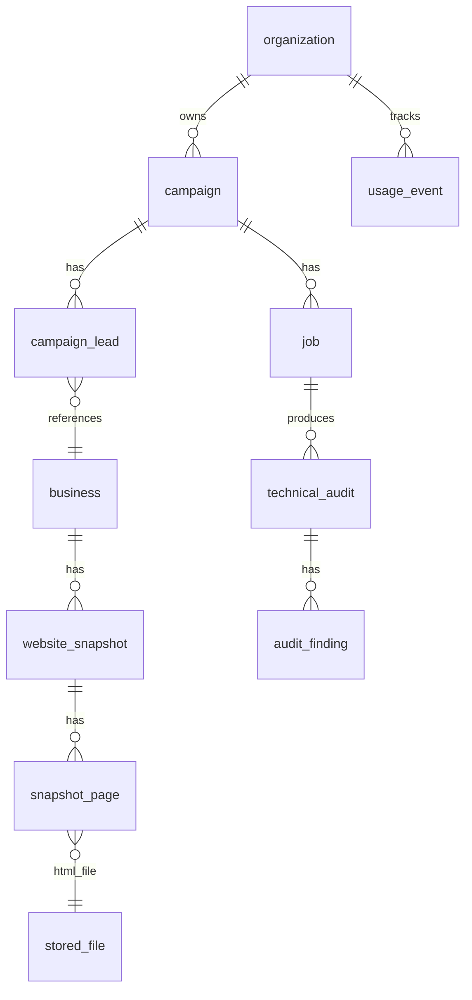

# RoveAI — Full System Knowledge Graph
> Generated from live debugging session. Copy this into any new chat to give the LLM full context.

---

## 1. Repo Overview

```
roveAi/                         ← pnpm monorepo (Turborepo)
├── apps/
│   ├── api/                    ← Fastify API + 3 worker processes
│   │   ├── src/
│   │   │   ├── app.ts          ← HTTP server entry
│   │   │   ├── worker.ts       ← Discover worker entry (role="discover")
│   │   │   ├── entries/
│   │   │   │   ├── crawl.ts    ← Crawl worker entry  (role="crawl")
│   │   │   │   ├── psi.ts      ← PSI worker entry    (role="psi")
│   │   │   │   ├── run-role.ts ← Shared bootstrap for all workers
│   │   │   │   └── push-server.ts ← Used only when QUEUE_DRIVER=pubsub
│   │   │   ├── core/
│   │   │   │   ├── config.ts   ← Zod env validation (loadConfig())
│   │   │   │   ├── logger.ts   ← Pino logger
│   │   │   │   └── registry.ts ← Plugin registry
│   │   │   ├── features/
│   │   │   │   ├── campaigns/
│   │   │   │   │   ├── campaign.service.ts      ← HTTP handlers call this
│   │   │   │   │   ├── campaign.repository.ts   ← All DB ops for campaigns/leads
│   │   │   │   │   ├── discovery.service.ts     ← Discover worker logic
│   │   │   │   │   ├── normalize.ts             ← classifyWebsite(), normalizeName()
│   │   │   │   │   └── queries.ts               ← expandQueries() → 8 search strings
│   │   │   │   ├── audits/
│   │   │   │   │   ├── audit.workers.ts         ← buildAuditHandlers(), subscribeAuditRole()
│   │   │   │   │   ├── audit-scheduler.ts       ← AuditScheduler.schedule() → publishes CRAWL+PSI jobs
│   │   │   │   │   ├── audit-write.ts           ← replaceAudit(), finishJob()
│   │   │   │   │   ├── audit-join.ts            ← publishIfReady() → triggers interpret when both done
│   │   │   │   │   ├── crawl.service.ts         ← CrawlService.run() / execute()
│   │   │   │   │   ├── psi.service.ts           ← PsiService.run() / execute()
│   │   │   │   │   └── analyzers.ts             ← inspectPage(), analyzePages(), scoreFromFindings()
│   │   │   │   └── jobs/
│   │   │   │       └── job-lock.ts              ← claimJob(), releaseJob() (idempotency)
│   │   │   └── plugins/
│   │   │       ├── queue/
│   │   │       │   ├── queue.plugin.ts          ← Chooses pgboss or pubsub based on QUEUE_DRIVER
│   │   │       │   ├── pgboss.plugin.ts         ← PgBossPlugin: publish(), subscribe()
│   │   │       │   ├── pubsub.plugin.ts         ← Google Pub/Sub (production)
│   │   │       │   └── queue.types.ts           ← DISCOVER_QUEUE, CRAWL_QUEUE, PSI_QUEUE constants
│   │   │       ├── maps/
│   │   │       │   ├── maps.plugin.ts           ← MapsPlugin: resolveActive() picks provider
│   │   │       │   ├── apify.provider.ts        ← ApifyMapsProvider (default)
│   │   │       │   └── maps.types.ts            ← MapsBusiness, MapsProvider interface
│   │   │       └── pagespeed/
│   │   │           ├── pagespeed.plugin.ts      ← PagespeedPlugin.runMobile()
│   │   │           ├── pagespeed.types.ts       ← PagespeedError, PagespeedUnreachableError
│   │   │           └── parse-report.ts          ← parsePagespeedReport()
│   │   └── prisma/
│   │       ├── schema.prisma   ← Single source of truth for DB schema
│   │       └── migrations/     ← Applied migrations (latest: 20261024072234)
│   └── dashboard/              ← React/Vite frontend (port 5173)
└── packages/                   ← Shared packages
```

---

## 2. Key Environment Variables (`apps/api/.env`)

| Variable | Required | Purpose |
|---|---|---|
| `DATABASE_URL` | ✅ | PostgreSQL connection (also used by pg-boss) |
| `DIRECT_URL` | dev only | For Prisma CLI migrations |
| `APIFY_TOKEN` | ✅ | Apify API token for Google Maps scraping |
| `APIFY_ACTOR` | optional | Default: `scraperlink/google-maps-scraper` |
| `PAGESPEED_API_KEY` | prod | Google PageSpeed Insights API key |
| `QUEUE_DRIVER` | optional | `pgboss` (default, local) or `pubsub` (GCP prod) |
| `BETTER_AUTH_SECRET` | ✅ | Min 32 chars, auth sessions |
| `BETTER_AUTH_URL` | ✅ | e.g. `http://localhost:3000` |
| `WORKER_CONCURRENCY` | optional | Default 2 |
| `CRAWL_MAX_PAGES` | optional | Default 8, max 10 |
| `GCP_PROJECT_ID` | pubsub only | Required when `QUEUE_DRIVER=pubsub` |

---

## 3. How to Start Everything (Development)

```bash
# Terminal 1 — API server
pnpm --filter @rove/api dev

# Terminal 2 — Discover worker  
pnpm --filter @rove/api dev:worker

# Terminal 3 — Crawl worker
pnpm --filter @rove/api dev:worker:crawl

# Terminal 4 — PSI worker
pnpm --filter @rove/api dev:worker:psi

# Terminal 5 — Dashboard
pnpm --filter @rove/dashboard dev
```

All workers use `nodemon` → auto-restart on file change.

---

## 4. Queue Architecture

### QUEUE_DRIVER=pgboss (default, local dev)
```
pg-boss uses the SAME PostgreSQL database.
Creates a "pgboss" schema internally.
Workers POLL the DB every ~1s for new jobs.
Each worker process subscribes to exactly ONE queue.
```

### QUEUE_DRIVER=pubsub (GCP production)
```
Uses Google Cloud Pub/Sub.
Workers run as HTTP push-server endpoints.
Each role gets a separate Pub/Sub subscription.
Requires: GCP_PROJECT_ID, PUBSUB_PUSH_AUDIENCE, GCS_BUCKET
```

### Queue Names (constants in `queue.types.ts`)
| Constant | Queue Name | Worker |
|---|---|---|
| `DISCOVER_QUEUE` | `campaign.discover` | `dev:worker` |
| `CRAWL_QUEUE` | `audit.crawl` | `dev:worker:crawl` |
| `PSI_QUEUE` | `audit.psi` | `dev:worker:psi` |

---

## 5. Complete Campaign Workflow

```
USER clicks "Run Campaign" in Dashboard
         │
         ▼
POST /api/campaigns/:id/run
CampaignService.run()
  → claimRun()                → campaign.status = "QUEUED"
  → mapsUsedThisMonth()       → quota check (usage_event table)
  → createJob(kind=DISCOVER)  → job row created (status=PENDING)
  → queue.publish(DISCOVER_QUEUE, { campaignId, jobId })
         │
         ▼ [Discover Worker picks up from pg-boss]
DiscoveryService.run(campaignId, jobId)
  → beginJob()                → job.status = "PROCESSING"
  → loadForDiscovery()        → loads campaign + exclusion_domain rows
  → markDiscovering()         → campaign.status = "DISCOVERING"
  → expandQueries(campaign)   → 8 search strings
  → for each query:
      maps.search(query)
        → MapsPlugin.resolveActive()
            → PlatformSettingsRepository.getDiscoveryProvider()
            → picks APIFY (or FIXTURE in test)
        → ApifyMapsProvider.search()
            → POST apify.com/.../run-sync-get-dataset-items (BLOCKING)
            → normalizeApify() → MapsBusiness[]
      for each business:
        classifyWebsite(url)  → OWNED_SITE | SOCIAL_OR_DIRECTORY | MISSING
        passesFilters()       → minRating, minReviewCount, websiteFilter
        saveLead()            → upsert business + insert campaign_lead
  → AuditScheduler.schedule(campaignId)
      → campaign.status = "PROCESSING"
      → for each PENDING lead with OWNED_SITE:
          ensureJob(CRAWL) → job row + queue.publish(CRAWL_QUEUE, payload)
          ensureJob(AUDIT) → job row + queue.publish(PSI_QUEUE, payload)
  → setJobStatus(COMPLETED)
         │
         ├──────────────────────────────────────────┐
         ▼                                          ▼
[Crawl Worker]                              [PSI Worker]
CrawlService.run()                          PsiService.run()
  → claimJob()                                → claimJob()
  → reuseRecent() (24h cache)                → reuseToday() (same-day cache)
  → fetch robots.txt                          → pagespeed.runMobile(url)
  → fetch homepage                               → GET googleapis.com/pagespeedonline/v5/...
  → fetch sitemap.xml                            → parsePagespeedReport()
  → selectCrawlUrls() (up to 8)              → storage.put(json)
  → fetch each page                           → storedFile.create()
  → inspectPage() per page                    → replaceAudit(PERFORMANCE module)
  → storeSnapshot()                           → usageEvent(LIGHTHOUSE_RUN)
      → websiteSnapshot.create()              → publishIfReady()
      → snapshotPage.create() per page        → finishJob(COMPLETED)
      → storedFile.create() per HTML
  → analyzePages()
      → replaceAudit(TECHNICAL_SEO)
      → replaceAudit(WEBSITE_EXPERIENCE)
  → usageEvent(WEBSITE_PAGE)
  → publishIfReady()
  → finishJob(COMPLETED)
         │
         ▼ [publishIfReady: both CRAWL+PSI done?]
queue.publish("campaign.interpret", payload)
  → AI brief generation (INTERPRET worker)
```

---

## 6. Database Tables — What Each Stores



| Table | Written By | Purpose |
|---|---|---|
| `organization` | Auth/signup | Multi-tenant root. Holds `pageFetchLimit`, `lighthouseRunLimit`, `mapsRecordLimit` |
| `campaign` | `CampaignService.create()` | A research batch: niche + city + filters. Status machine: `DRAFT→QUEUED→DISCOVERING→PROCESSING→COMPLETED/PARTIALLY_COMPLETED/FAILED` |
| `job` | `CampaignService.run()` / `AuditScheduler` | One row per queue job. `kind`: `DISCOVER/CRAWL/AUDIT/INTERPRET`. Tracks `status`, `attemptCount`, `queueJobId` |
| `business` | `CampaignRepository.saveLead()` | The actual place from Google Maps. Shared across campaigns (upsert by `providerId`) |
| `business_identity` | `saveLead()` | Normalized name/phone for deduplication |
| `campaign_lead` | `saveLead()` | Links campaign ↔ business. Holds `auditStatus`, `qualificationStatus` |
| `exclusion_domain` | `CampaignService.create()` | Domains to skip (existing clients) |
| `website_snapshot` | `CrawlService.storeSnapshot()` | One snapshot per unique site content-hash. Stores title, h1s, tech stack, page count |
| `snapshot_page` | `storeSnapshot()` | One row per crawled page. Stores extracted SEO data (canonical, robots, CTAs, etc.) |
| `stored_file` | `storeSnapshot()` / `PsiService` | Pointer to file on disk or GCS. Kinds: `HTML`, `PSI_JSON` |
| `technical_audit` | `replaceAudit()` | One row per job×module combo. Modules: `TECHNICAL_SEO`, `WEBSITE_EXPERIENCE`, `PERFORMANCE`. Stores score + metrics |
| `audit_finding` | `replaceAudit()` | Individual issues per audit (missing H1, slow render, etc.) Severity: `LOW/MEDIUM/HIGH/CRITICAL` |
| `usage_event` | Workers | Quota tracking. Kinds: `MAPS_RECORD`, `WEBSITE_PAGE`, `LIGHTHOUSE_RUN` |
| `platform_setting` | Admin | Global defaults. Stores `discoveryProvider` (which maps API to use) |
| `pgboss.*` | pg-boss library | Internal queue state (jobs, queues, schedules). Lives in `pgboss` schema |

---

## 7. Lead Classification Logic (`normalize.ts`)

```
websiteUrl → classifyWebsite(url) → WebsiteClass
  null / empty    → MISSING
  instagram.com   → SOCIAL_OR_DIRECTORY
  facebook.com    → SOCIAL_OR_DIRECTORY
  yelp.com        → SOCIAL_OR_DIRECTORY
  justdial.com    → SOCIAL_OR_DIRECTORY
  (own domain)    → OWNED_SITE

WebsiteClass → auditStatus (set at lead creation)
  MISSING           → SKIPPED_NO_WEBSITE     (score=95 — high opportunity)
  SOCIAL_OR_DIRECTORY → SKIPPED_NOT_OWNED_SITE (score=50)
  OWNED_SITE        → PENDING               (will be crawled + PSI'd)
```

---

## 8. Apify Provider Details

**Actor:** `scraperlink/google-maps-scraper` (configured via `APIFY_ACTOR` env)

**Important constraint:** `num` field **must be >= 10** — the actor rejects requests with fewer.
The code clamps: `Math.max(input.limit, 10)` — so a `maxLeads=5` campaign still works.

**Input format:**
```json
{ "query": ["Plumbing in Srinagar, Jammu and Kashmir"], "num": 10 }
```

**Response normalization** (`normalizeApify()`): maps `title→name`, `placeId→providerId`, `totalScore→rating`, `reviewsCount→reviewCount`, `website→websiteUrl`

**Endpoint used:** `run-sync-get-dataset-items` — blocks until actor finishes, no polling needed.

---

## 9. PSI Error Handling (Fixed in This Session)

PSI returns **HTTP 400** in two cases:

| Case | Meaning | Handling |
|---|---|---|
| Bad API params | Code bug | `PagespeedError` → retry |
| `FAILED_DOCUMENT_REQUEST` / `net::ERR_*` | Target site is DOWN | `PagespeedUnreachableError` → record `UNREACHABLE`, **no retry** |

Detection regex in `pagespeed.plugin.ts`:
```typescript
/FAILED_DOCUMENT_REQUEST|ERR_NAME_NOT_RESOLVED|ERR_CONNECTION|ERR_TIMED_OUT|net::/i
```

---

## 10. Bugs Fixed in This Session

### Bug 1: `DiscoveryProvider` enum missing `APIFY`
- **Error:** `invalid input value for enum "DiscoveryProvider": "APIFY"`
- **Cause:** `APIFY` added to `schema.prisma` but migration never run
- **Fix:** `prisma migrate dev --name add_apify_discovery_provider`
- **Migration:** `ALTER TYPE "DiscoveryProvider" ADD VALUE 'APIFY'`
- **File:** `prisma/migrations/20261024072234_add_apify_discovery_provider/migration.sql`

### Bug 2: Apify HTTP 400 — `num must be >= 10`
- **Error:** `Apify actor responded with HTTP 400: Field input.num must be >= 10`
- **Cause:** Campaign with `maxLeads=5` passed `limit=5` to Apify, which enforces minimum 10
- **Fix:** `Math.max(input.limit, SCRAPERLINK_MIN_RESULTS)` in `buildActorInput()`
- **File:** `apps/api/src/plugins/maps/apify.provider.ts`

### Bug 3: PSI HTTP 400 on unreachable sites burning retries
- **Error:** `PageSpeed Insights returned HTTP 400` — 3× per lead, then `FAILED`
- **Cause:** Sites were genuinely down; PSI returns 400 for `FAILED_DOCUMENT_REQUEST`
- **Fix:** Added `PagespeedUnreachableError`, detect in plugin, handle in service → immediate `UNREACHABLE`, no retries
- **Files:** `pagespeed.types.ts`, `pagespeed.plugin.ts`, `psi.service.ts`

---

## 11. Worker Bootstrap Flow (detailed)

```
runRole("discover" | "crawl" | "psi")       [entries/run-role.ts]
  │
  ├─ if QUEUE_DRIVER=pubsub → startPushServer(role) [HTTP endpoint for GCP push]
  │
  └─ if QUEUE_DRIVER=pgboss (default):
       registerAllPlugins(registry)
         → PrismaPlugin.initialize()    → connects Prisma client
         → QueuePlugin.initialize()     → starts pg-boss (boss.start())
         → MapsPlugin.initialize()      → registers APIFY+FIXTURE providers
         → FetchPlugin.initialize()     → HTTP fetcher with SSRF protection
         → StoragePlugin.initialize()   → local disk or GCS
         → PagespeedPlugin.initialize() → loads API key
       subscribeAuditRole(registry, role)
         → buildAuditHandlers(registry) → instantiates all services
         → queue.subscribe(QUEUE_NAME, handler)
           → boss.work(queue, { localConcurrency }, wrappedHandler)
```

---

## 12. Job Idempotency Pattern (`job-lock.ts`)

Every worker checks this before doing work:
```typescript
claimJob(prisma, jobId, timeoutMs)
  → UPDATE job SET status='PROCESSING', attemptCount+=1
    WHERE id=jobId AND (status='PENDING' OR (status='PROCESSING' AND updatedAt < staleBefore))
  → returns "ready"  — this process owns the job, proceed
  → returns "owned"  — another process has it, skip
  → returns "done"   — already COMPLETED/FAILED/CANCELLED, skip
```

This prevents duplicate execution even if pg-boss delivers the same job twice.

---

## 13. Campaign Status Machine

```
DRAFT
  → QUEUED         (user clicks Run)
  → DISCOVERING    (discover worker started)
  → PAUSED         (quota hit mid-discovery but some leads saved)
  → PROCESSING     (discovery done, crawl+PSI running)
  → COMPLETED      (all leads audited successfully)
  → PARTIALLY_COMPLETED (some leads UNREACHABLE/FAILED)
  → FAILED         (discovery failed with 0 leads saved)
  → CANCELLED      (user cancelled)
```

---

## 14. auditStatus Machine (per campaign_lead)

```
Set at lead creation (by discovery):
  PENDING              → has website, will be crawled
  SKIPPED_NO_WEBSITE   → no website found
  SKIPPED_NOT_OWNED_SITE → social/directory URL

Updated by workers:
  COMPLETED            → crawl+PSI done
  UNREACHABLE          → site is down (HTTP error / PSI FAILED_DOCUMENT_REQUEST)
  BLOCKED              → robots.txt blocked / SSRF blocked
  SKIPPED_BY_ROBOTS    → robots.txt disallowed homepage
  SKIPPED_BUDGET       → org hit pageFetch or lighthouse limit
  FAILED               → unexpected error after all retries
```

---

## 15. Score Heuristic (current — pre-full-audit)

Until all audits run, the dashboard shows a **heuristic score**:

| Situation | Score | Reasoning |
|---|---|---|
| No website | 95 | Maximum need for web services |
| No website + high reviews | 95 | Established business, no web presence |
| Owned site, poor audit | 60 | Has site but needs work |
| Owned site, good audit | 55 | Less opportunity |
| Social only | 50 | Less actionable |
| Unreachable | 0 | Can't audit / low confidence |

---

## 16. Key Relationships for Future LLM Context

```
campaign → campaign.service.ts → CampaignService.run()
                                      ↓ publishes to
                                 campaign.discover queue
                                      ↓ consumed by
                                 worker.ts → discovery.service.ts → DiscoveryService
                                      ↓ after leads saved
                                 audit-scheduler.ts → AuditScheduler.schedule()
                                      ↓ publishes to
                              ┌───────────────────────┐
                              ↓                       ↓
                         audit.crawl           audit.psi
                              ↓                       ↓
                    crawl.service.ts         psi.service.ts
                    CrawlService.run()       PsiService.run()
                              ↓                       ↓
                    technical_audit          technical_audit
                    (TECHNICAL_SEO)          (PERFORMANCE)
                    (WEBSITE_EXPERIENCE)
                              ↓                       ↓
                              └─── publishIfReady() ──┘
                                      ↓ both done?
                               campaign.interpret queue
                                      ↓
                               AI brief generation
```
