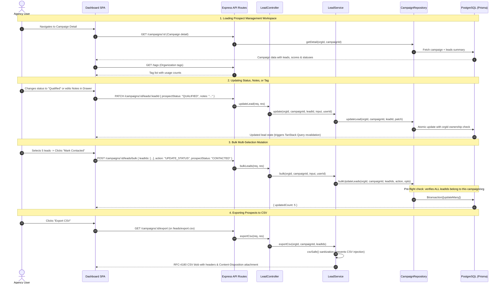

# Rove AI: Prospect Management Workspace & Evidence-Based Lead Scoring Architecture

## 1. Executive Summary & Design Principles

This document specifies the end-to-end architecture, lifecycle workflows, data contracts, and function registries for:
1. **The Tri-State / Quad-State Verification Contract & Non-Destructive Audit History**
2. **The 3D Lead Scoring Model (`LeadScoreBreakdown`)**
3. **The Prospect Management Workspace** (the 7 core features: Prospect Table, Search & Filters, Save & Archive, Tags & Notes, Status Tracking & Next Action Engine, Bulk Actions, CSV Export)

---

## 2. Architectural Tradeoffs & Core Resolutions

### 2.1 The Tri-State / Quad-State Verification Contract

#### The Flaw of Traditional Boolean / Null Models
In naive scraping, an attribute missing from an API response is stored as `null`. This conflates three fundamentally distinct realities:
- **Case A**: The scraper visited the page, parsed the DOM thoroughly, and verified that no phone number exists on the site.
- **Case B**: The scraper was blocked by Cloudflare (403), timed out, or crashed, meaning we have **no information**.
- **Case C**: The scraper was never scheduled to check for phone numbers (skipped due to budget or missing prerequisites).

Treating Case B or C as Case A produces catastrophic false positives for agencies (e.g. telling a client "you don't have a phone number" when their site was simply unreachable during the audit).

#### The Quad-State Contract Solution
Every probe and enrichment field uses a strict 4-state state machine:
- `PRESENT`: Confirmed observed with positive evidence.
- `VERIFIED_ABSENT`: Inspection completed successfully with authoritative evidence confirming non-existence.
- `AUDIT_FAILED`: Inspection was attempted, but the tool failed, crashed, timed out, or was blocked.
- `NOT_ASSESSED`: Inspection was not performed (skipped due to plan limit, unsupported technology, or prerequisite failure).

#### Field-Level Tri-State vs Module-Level Status
- **Module-Level** (`TechnicalAudit.status`): High-level operational state (`COMPLETED`, `FAILED`, `BLOCKED`, `UNREACHABLE`).
- **Field-Level** (`Business.enrichmentState Json`): Structured object containing verification states for individual fields (`phone`, `email`, `address`, `rating`, `reviewCount`). `providerRaw` is retained as immutable source evidence.

---

### 2.2 Audit Freshness Precedence & Attempt History

#### The Retry Dilemma
When an audit fails on retry (e.g. transient 500 error), simply overwriting `TechnicalAudit` destroys previously verified findings. Conversely, silently ignoring the failure hides the fact that the website is currently failing or unreachable.

#### The Dual-Model Solution
1. **`AuditAttempt` (Append-Only Execution History)**:
   - Every single crawler/audit execution creates an immutable `AuditAttempt` row with atomic attempt numbering (`@@unique([jobId, module, attemptNumber])`).
   - Records the raw status (`COMPLETED`, `FAILED`, `BLOCKED`), execution duration, and error codes.
2. **`TechnicalAudit` (Canonical Latest Succeeded Evidence)**:
   - Stores the authoritative findings used for scoring and sales briefings.
   - Protected by monotonic timestamp guards: a failed retry logs a new `AuditAttempt` but does **not** wipe out historical findings in `TechnicalAudit`.
3. **Freshness Precedence Order**:
   - `UNAUDITED`: No successful audit has ever completed.
   - `DEGRADED`: The latest attempt failed, but past successful evidence exists.
   - `STALE`: The latest attempt succeeded, but the evidence age exceeds the freshness threshold (30 days).
   - `FRESH`: The latest attempt succeeded and evidence is within the freshness window.

---

### 2.3 The 3D Lead Scoring Model (`LeadScoreBreakdown`)

```typescript
interface LeadScoreBreakdown {
  gapIndex: number;            // 0-100: Technical deficiencies & web presence gaps
  agencyFitScore: number;      // 0-100: Alignment with agency's specific services
  commercialViability: number; // 0-100: Business viability (reviews, ratings, activity)
  priorityRank?: number;       // 0-100: Renormalized composite score
  disclaimer: "Gap Index reflects technical deficiencies and potential service need. It is NOT a predictive probability of purchase.";
}
```

#### Dimension Rules & Fallbacks
1. **`gapIndex` (0–100)**:
   - Combines **Presence Gap** (Missing Website = 90, Social-Only = 65, Directory-Only = 55) with **Technical Gap** (14 probes across Performance, Mobile, SEO, and Security).
   - Anti-duplication category caps prevent a single broken script from maxing out multiple categories.
2. **`commercialViability` (0–100)**:
   - Independent volume signal (0–50 based on `reviewCount`) + sentiment signal (0–50 based on `rating`).
   - If reviews or ratings are `AUDIT_FAILED` or `NOT_ASSESSED`, the dimension is marked unavailable rather than assuming 0.
3. **`agencyFitScore` (0–100)**:
   - Evaluated using a strict 3-tier hierarchy: Campaign-specific service config $\rightarrow$ Organization ServiceProfile $\rightarrow$ Neutral Unknown (score 50, availability partial).
4. **Composite Priority Calculation & Renormalization**:
   $$P = \frac{\sum (\text{available dimension score} \times \text{weight})}{\sum \text{available weights}}$$
   - Gated by minimum evidence coverage ($\ge 0.50$). If coverage $< 0.50$, the composite priority rank is `null`, preventing misleading zero scores.

---

## 3. Prospect Management Workspace Architecture

The workspace implements the 7 core features requested:

```
┌─────────────────────────────────────────────────────────────────────────────────────────────┐
│ Prospect Management Workspace                                                               │
├─────────────────────────────────────────────────────────────────────────────────────────────┤
│ [Search & Filters Bar]                                                                      │
│ Tabs: All (85) | Qualified (24) | Researched (32) | Contacted (18) | Saved (12) | Archived (5)│
│ Search: [ Business, City, Domain... ]  Score: [ All / High 75+ / Med / Low ]  Tag: [ All ]  │
├─────────────────────────────────────────────────────────────────────────────────────────────┤
│ [Prospect Table]                                                                            │
│ [x]  ★  Smile Dental   · Austin · Owned site   [ 87 ]   [ Qualified  v ]   [ Review evidence ]│
│ [ ]  ☆  City Dental    · Dallas · Owned site   [ 64 ]   [ Researched v ]   [ Check service fit]│
│ [ ]  ★  Bright Clinic  · Houston · Social-only [ 32 ]   [ Contacted  v ]   [ Follow up       ]│
├─────────────────────────────────────────────────────────────────────────────────────────────┤
│ [Floating Bulk Action Bar] (appears when 1+ rows checked)                                   │
│  3 selected | Set status: [ Select v ] | Add tag: [ Select v ] | [ Save ] [ Archive ] [ CSV]│
└─────────────────────────────────────────────────────────────────────────────────────────────┘
```

### Feature Implementation Matrix
| Feature | DB / Storage | Backend Handling | Frontend Component |
| :--- | :--- | :--- | :--- |
| **1. Prospect Table** | `CampaignLead` | `getLeadsSummary()` (lightweight rows without heavy audit findings) | `ProspectTable.tsx` |
| **2. Search & Filters** | Indexed DB columns | Prisma `contains` (case-insensitive) on name, city, domain + score ranges | `ProspectFilters.tsx` |
| **3. Save & Archive** | `savedAt`, `savedByUserId`, `archivedAt` | Soft-archive via `archivedAt != null`; saved toggle via `savedAt` | `ProspectTable.tsx`, `ProspectFilters.tsx` |
| **4. Tags & Notes** | `ProspectTag`, `LeadTag`, `notes` (`@db.Text`) | Org-isolated tag CRUD + single lead atomic notes update | `LeadBriefDrawer.tsx`, `ProspectTable.tsx` |
| **5. Status Tracking** | `prospectStatus` enum (`NEW`, `RESEARCHED`, `QUALIFIED`, `CONTACTED`, `DISMISSED`) | Deterministic Next Action Engine (no LLM latency) | `computeNextAction()`, `ProspectTable.tsx` |
| **6. Bulk Actions** | Prisma multi-row `$transaction` | Pre-flight IDOR campaign/org ownership check + tag ownership check | `BulkActionBar.tsx` |
| **7. CSV Export** | Dynamic stream / download | RFC-4180 export with formula injection sanitization (`\t` prefix) | `exportCsv()` in service & controller |

---

## 4. End-to-End System Workflow



---

## 5. Function Registry & File Reference

### 5.1 Backend Services & Handlers (`apps/api`)

#### File: `apps/api/src/features/audits/evidence-state.ts`
- **`resolveFreshness(lastAttempt, lastSuccessfulAudit, thresholdDays)`**: Resolves audit state (`UNAUDITED`, `DEGRADED`, `STALE`, `FRESH`).
- **`classifyProbe(code, evidence)`**: Maps raw metrics into Quad-State (`PRESENT`, `VERIFIED_ABSENT`, `AUDIT_FAILED`, `NOT_ASSESSED`).
- **`computeProbeCoverage(probes)`**: Calculates applicable evidence coverage.

#### File: `apps/api/src/features/audits/audit-write.ts`
- **`replaceAudit(prisma, input)`**: Writes an immutable `AuditAttempt` and updates canonical `TechnicalAudit` without destroying historical evidence on retry failure.

#### File: `apps/api/src/features/audits/scoring/lead-scoring.ts`
- **`computeLeadScoreBreakdown(input)`**: Orchestrates Gap Index, Agency Fit, and Commercial Viability into `LeadScoreBreakdown` with coverage gating ($\ge 0.50$) and mandatory disclaimer.

#### File: `apps/api/src/features/campaigns/lead.service.ts`
- **`computeNextAction(lead)`**: Pure deterministic engine mapping `prospectStatus`, `auditStatus`, `aiStatus`, and `archivedAt` into user action recommendations (e.g. "Review evidence", "Check service fit", "Follow up", "Pitch web design").
- **`csvSafe(value)`**: Sanitizes strings against CSV formula injection (`=`, `+`, `-`, `@`, `\t`, `\r` prefixes).
- **`LeadService.list(orgId, campaignId, query)`**: Paginated lead retrieval with server-side filters.
- **`LeadService.getDetail(orgId, campaignId, leadId)`**: Fetches complete lead record including findings and brief.
- **`LeadService.update(orgId, campaignId, leadId, input, userId)`**: Updates single lead with tag ownership validation.
- **`LeadService.bulk(orgId, campaignId, input, userId)`**: Executes bulk mutations with pre-flight IDOR guards.
- **`LeadService.listTags(orgId)` / `createTag()` / `deleteTag()`**: Manages organization tags.
- **`LeadService.exportCsv(orgId, campaignId, leadIds)`**: Streams RFC-4180 CSV with sanitized headers.

#### File: `apps/api/src/features/campaigns/lead.controller.ts`
- **`LeadController.listLeads`**: HTTP GET handler for paginated query.
- **`LeadController.getLead`**: HTTP GET handler for single lead drawer data.
- **`LeadController.updateLead`**: HTTP PATCH handler for lead mutation.
- **`LeadController.bulkLeads`**: HTTP POST handler for bulk operations.
- **`LeadController.exportCsv`**: HTTP GET handler returning CSV file stream.
- **`LeadController.listTags` / `createTag` / `deleteTag`**: Tag endpoints.

#### File: `apps/api/src/features/campaigns/campaign.repository.ts`
- **`CampaignRepository.getLeadsSummary(orgId, campaignId, opts)`**: High-performance query selecting only table summary columns without findings trees.
- **`CampaignRepository.getLeadDetail(orgId, campaignId, leadId)`**: Deep join query for drawer.
- **`CampaignRepository.updateLead(...)`**: Transactional lead updater.
- **`CampaignRepository.bulkUpdateLeads(...)`**: Atomic multi-lead updater with ownership validation.
- **`CampaignRepository.getLeadsForExport(...)`**: Unpaginated export query.

#### File: `apps/api/src/features/campaigns/campaign.routes.ts`
- **`campaignsRouter(deps)`**: Express router mounting campaign and lead workspace routes.
- **`tagsRouter(deps)`**: Express router mounting organization tag CRUD endpoints.

---

### 5.2 Frontend Components & Hooks (`apps/dashboard`)

#### File: `apps/dashboard/src/features/campaigns/domain/campaign.ts`
- **`computeNextAction(lead)`**: Mirrors backend derivation for optimistic UI updates.
- **`prospectStatusLabel(status)` / `prospectStatusTone(status)`**: Visual mapping for status badges.
- **`heuristicScore(lead)` / `scoreTone(score)`**: Fallback opportunity scoring for un-audited prospects.

#### File: `apps/dashboard/src/features/campaigns/infrastructure/campaignApi.ts`
- **`updateLead(orgId, campaignId, leadId, payload)`**: Axios PATCH client.
- **`bulkUpdateLeads(orgId, campaignId, payload)`**: Axios POST bulk client.
- **`listTags(orgId)` / `createTag()` / `deleteTag()`**: Tag API clients.
- **`downloadCampaignCsv(orgId, campaignId, leadIds)`**: Blob-based browser download trigger.

#### File: `apps/dashboard/src/features/campaigns/application/useCampaigns.ts`
- **`useUpdateLead`**: TanStack Query mutation for single lead updates with cache invalidation.
- **`useBulkUpdateLeads`**: TanStack Query mutation for bulk mutations.
- **`useTags` / `useCreateTag` / `useDeleteTag`**: Hooks for agency tag management.
- **`useDownloadCsv`**: Mutation hook for CSV export.

#### File: `apps/dashboard/src/features/campaigns/presentation/ProspectFilters.tsx`
- **`ProspectFilters`**: Renders view tabs (*All*, *Qualified*, *Researched*, *Contacted*, *Saved*, *Archived*), search input, score tier selector, tag selector, and reset button.

#### File: `apps/dashboard/src/features/campaigns/presentation/BulkActionBar.tsx`
- **`BulkActionBar`**: Floating action bar rendering selected count, status dropdown, tag adder, save toggle, archive toggle, and export button.

#### File: `apps/dashboard/src/features/campaigns/presentation/ProspectTable.tsx`
- **`ProspectTable`**: Renders table rows with selection checkboxes, star bookmark, business details, score pill, status dropdown, next action chip, tags display, and archive/drawer controls.

#### File: `apps/dashboard/src/features/campaigns/presentation/LeadBriefDrawer.tsx`
- **`LeadBriefDrawer`**: Slide-out drawer with 3 tabs: *Opportunity Brief*, *Audit Findings*, and *Notes & Context* (editable textarea, save button, status selector, and tags).

#### File: `apps/dashboard/src/features/campaigns/presentation/CampaignDetailPage.tsx`
- **`CampaignDetailPage`**: Orchestrates state between `ProspectFilters`, `ProspectTable`, `BulkActionBar`, and `LeadBriefDrawer`.

---

## 6. Files Introduced in These Changes

| Directory | File | Purpose |
| :--- | :--- | :--- |
| `apps/api/prisma/migrations/` | `20261111061658_prospect_workspace_fields/migration.sql` | Migration adding `ProspectStatus` enum, `prospectStatus`, `notes`, `archivedAt`, and indexes. |
| `apps/api/src/features/campaigns/` | `lead.schemas.ts` | Zod validation schemas for lead updates, bulk operations, tag management, and queries. |
| `apps/api/src/features/campaigns/` | `lead.service.ts` | Next action derivation engine, CSV injection protection, and lead business logic. |
| `apps/api/src/features/campaigns/` | `lead.controller.ts` | Express controllers for leads, bulk actions, tags, and CSV export. |
| `apps/api/src/features/campaigns/` | `lead.service.test.ts` | 16 unit tests for Next Action engine, CSV sanitization, and IDOR validation. |
| `apps/dashboard/src/features/campaigns/presentation/` | `ProspectTable.tsx` | Interactive prospect table matching target triage specifications. |
| `apps/dashboard/src/features/campaigns/presentation/` | `ProspectFilters.tsx` | View tabs, debounced search, score filters, and tag selector. |
| `apps/dashboard/src/features/campaigns/presentation/` | `BulkActionBar.tsx` | Floating toolbar for bulk mutations and export. |

